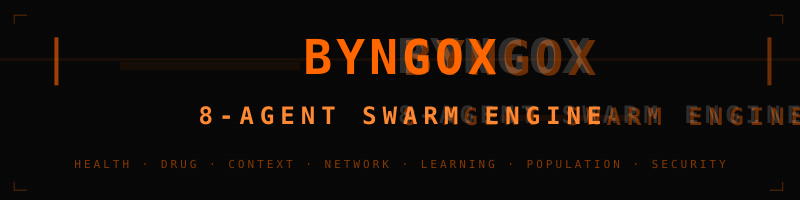
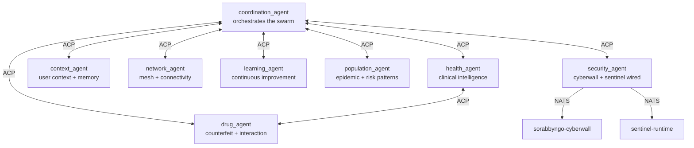

<p align="center">
  
</p>
<p align="center">
  <strong>Byngox — 8-Agent Swarm Reasoning Engine</strong><br/>
  The cognitive intelligence core of SORABBYNGO OS
</p>
<p align="center">
  
  
  
  
</p>

---

Byngox is the swarm intelligence engine of SORABBYNGO OS. Eight specialized agents communicate via ACP (Agent Communication Protocol) over NATS JetStream. Each agent owns a domain — health, drugs, context, network, learning, population, security, and coordination. Together they reason, decide, and act.

---

## Agent swarm



---

## Agents

| Agent | Domain | Key capability |
|---|---|---|
| `coordination_agent` | Orchestration | Routes queries, resolves conflicts, aggregates |
| `health_agent` | Clinical | Patient risk, symptom analysis, care pathway |
| `drug_agent` | Pharmacology | Counterfeit detection, drug interactions, supply chain |
| `context_agent` | User context | Memory, preferences, session state |
| `network_agent` | Connectivity | Mesh health, peer trust, offline sync |
| `learning_agent` | Improvement | Feedback loops, model fine-tuning signals |
| `population_agent` | Epidemiology | Disease patterns, risk maps, outbreak detection |
| `security_agent` | Defence | Cyberwall integration, threat correlation, escalation |

---

## ACP — Agent Communication Protocol

```
sorabbyngo.byngox.acp.<target_agent>
{
  "from":      "health_agent",
  "to":        "drug_agent",
  "action":    "check_interaction",
  "payload":   { "drugs": ["artemether", "lumefantrine"] },
  "timestamp": "2026-04-27T..."
}
```

---

## Quick start

```bash
# Start full swarm
python3 byngox_runtime.py

# Run tests
pytest tests/ -v
```

---

## Part of SORABBYNGO OS

| Repo | Role |
|---|---|
| [chameha](https://github.com/sorabbyngo-os/chameha) | Voice interface |
| [cml](https://github.com/sorabbyngo-os/cml) | Safety filter |
| [sorabbyngo-cyberwall](https://github.com/citadel-sec/sorabbyngo-cyberwall) | Security layer |
| [byngonet](https://github.com/sorabbyngo-os/byngonet) | Mesh network |

---

<p align="center">
  <strong>Sorabbyngo Company</strong> &nbsp;·&nbsp; Kisii, Kenya &nbsp;·&nbsp; 2026<br/>
  <em>Rhythm of Digital Life</em>
</p>
